# snisplit architecture for new developers

This page explains how the code fits together, with diagrams. It describes the
driverless design (PLAN.md, decision D1) as it stands at version 0.2.0. For why each
choice was made, read PLAN.md and the milestone records in `docs/`.

The diagrams are Mermaid; GitHub and most editors render them.

## 1. The idea in one picture

snisplit never decrypts anything. It only changes how the first bytes of a connection
are cut into TCP segments, so the provider's filter cannot read the server name in one
piece.

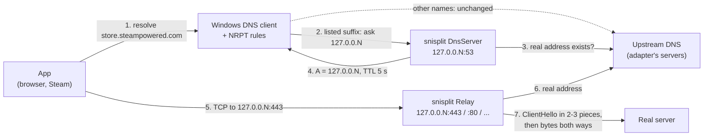

Each selected profile (site) gets its own loopback address, starting at `127.0.0.2`
(`crates/cli/src/plan.rs`). The NRPT rule for a profile's domains names that address as
the DNS server, the DNS server on that address answers with that same address, and the
relay listens on that address for the profile's ports. So the address alone tells the
relay which profile a connection belongs to.

## 2. Crates

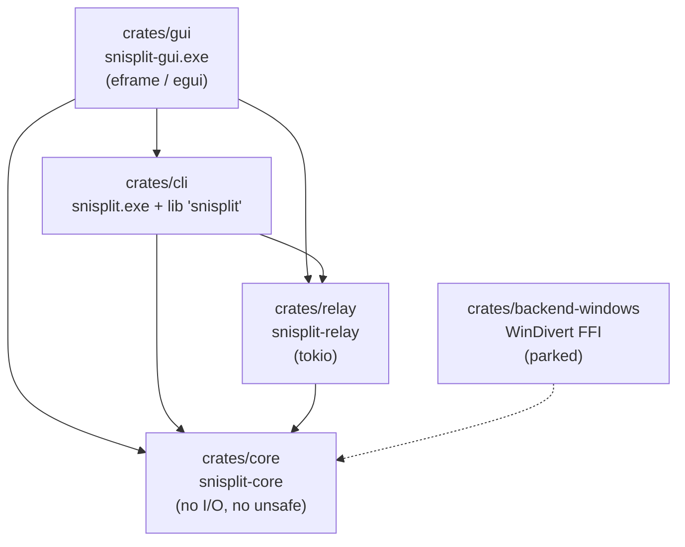

| Crate | Job | Main entry points |
|---|---|---|
| `core` | Pure byte logic: parse a ClientHello or HTTP request, find the host, match it against a domain list, compute cut offsets, DNS codec, `hoSt:` respelling, probe assessment. No sockets, so everything is unit-tested with fixtures. | `first_flight::decide`, `DomainList`, `Strategy`, `HostRespeller`, `dns`, `probe` |
| `relay` | The async network parts on tokio: the TCP relay, the DNS server, the upstream resolver, the probe. Knows nothing about files, Windows or profiles on disk. | `Relay`, `DnsServer`, `UdpResolver`, `Upstreams`, `probe::probe` |
| `cli` | Library and binary. Reads profiles and the site folder, picks loopback addresses, adds and removes NRPT rules through PowerShell, holds the single-instance lock, runs a session. | `session::serve`, `plan`, `routing`, `sites`, `instance` |
| `gui` | The window. A pure state machine (`state`) plus a driver that turns effects into calls on the `cli` library. | `State::update`, `Driver::run`, `Keeper` |
| `backend-windows` | Packet-level WinDivert code from the first design. Parked, not built into the release. | - |

Parked modules in `core` (unused by the relay, kept with their tests): `segment`,
`checksum`, `packet`, `flow`, `engine`, `pump`. Ignore them unless a packet-level
backend comes back.

## 3. Core: deciding about the first flight

The "first flight" is the first bytes the app sends: a TLS ClientHello on a TLS port,
an HTTP request head on an HTTP port.

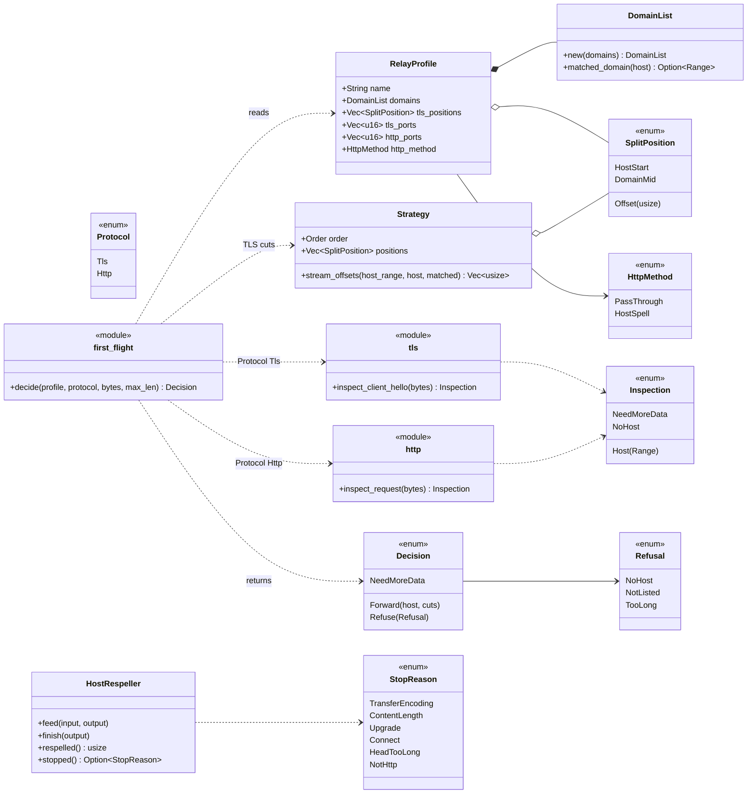

`decide` is the one function the relay calls on every new connection:

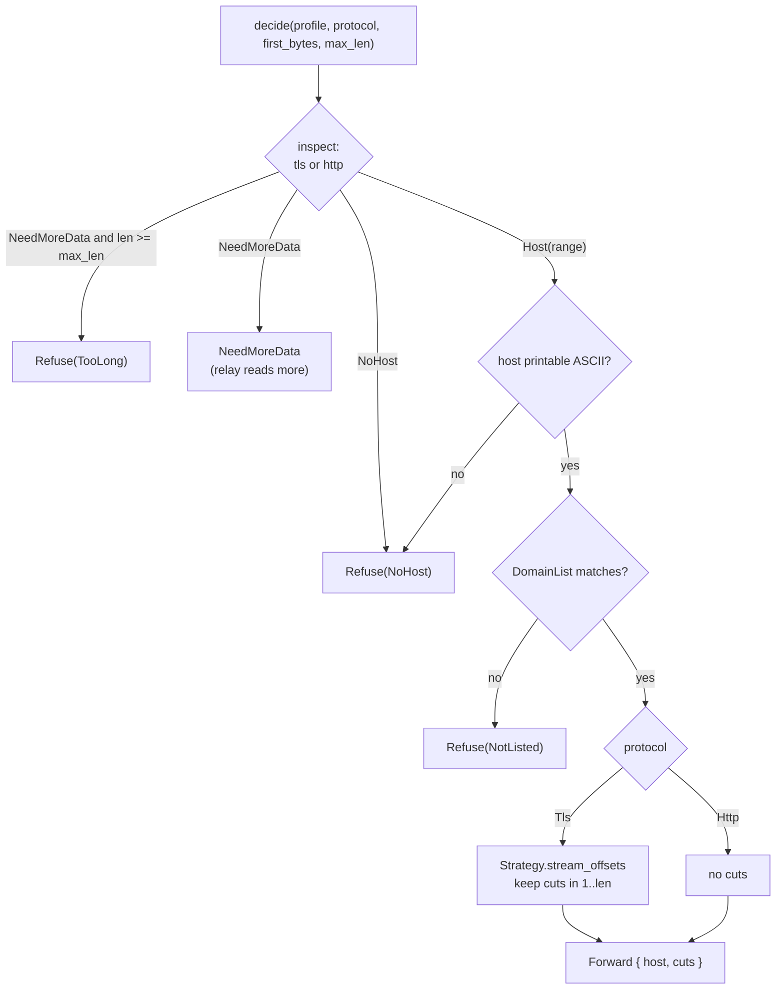

Split positions, for a ClientHello for `a.store.steampowered.com` with
`steampowered.com` listed:

- `Offset(1)`: after the first byte of the TLS record (the measured working cut).
- `HostStart`: right before `a.store...` inside the SNI extension.
- `DomainMid`: in the middle of the first label of the matched entry, `steamp|owered`.

HTTP is not cut. With `http-method host-spell`, `HostRespeller` rewrites the header name
`Host:` to `hoSt:` on every request head of a keep-alive connection, following
`Content-Length` framing, and stops (passes bytes through unchanged) on cases it cannot
frame safely: `StopReason`.

## 4. Relay crate

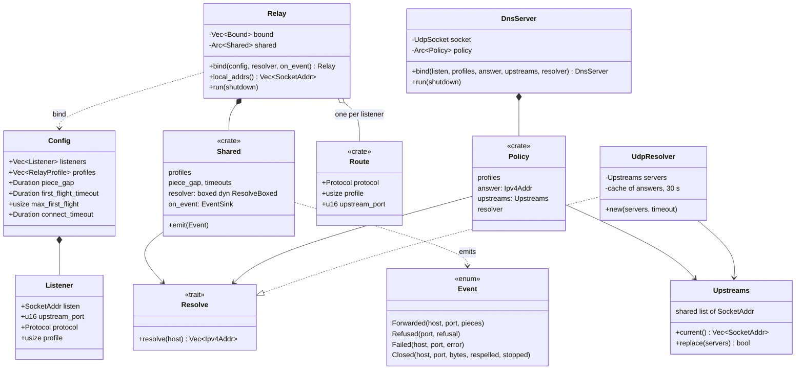

`Upstreams` is a shared, replaceable list: the session re-reads the adapter's DNS servers
every 30 s and swaps them in, and the resolver and every DNS server see the change.

### One TLS connection through the relay

`crates/relay/src/connection.rs`, `serve`:

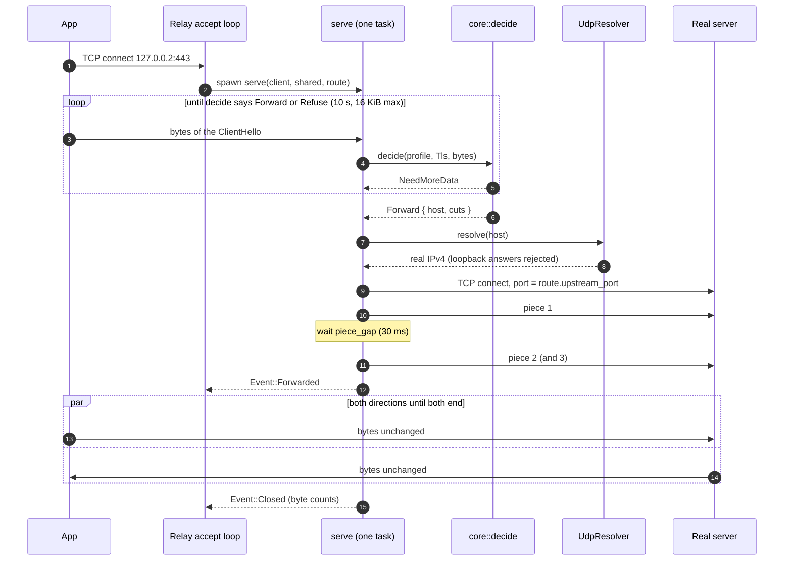

For an HTTP port the first flight is not cut; it goes through `HostRespeller`, and so
does the rest of the client-to-server direction (`copy_respelled`). A refusal or a
failure ends the connection and emits `Event::Refused` or `Event::Failed`.

### One DNS query

`crates/relay/src/dns_server.rs`:

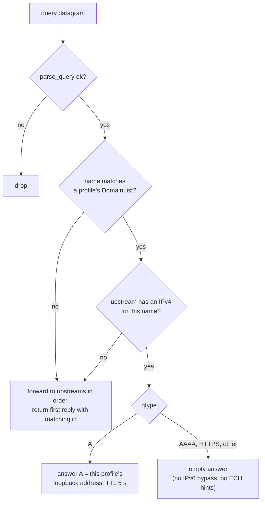

## 5. CLI crate: a session

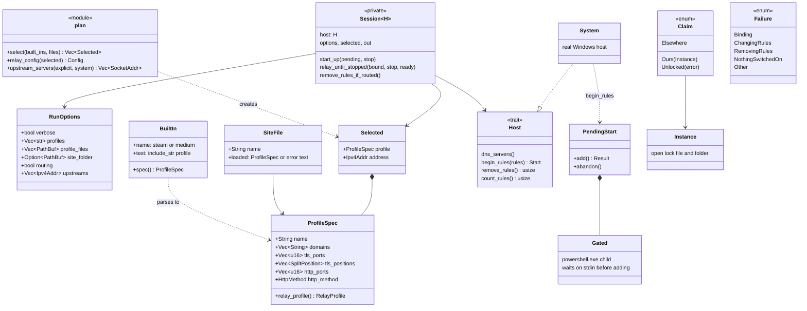

`Host` is the seam for tests: the real `System` reads adapter DNS servers and runs
PowerShell; tests pass a fake host, so no test needs administrator rights.

### `snisplit run` from start to Ctrl+C

`crates/cli/src/main.rs` and `crates/cli/src/session.rs`:

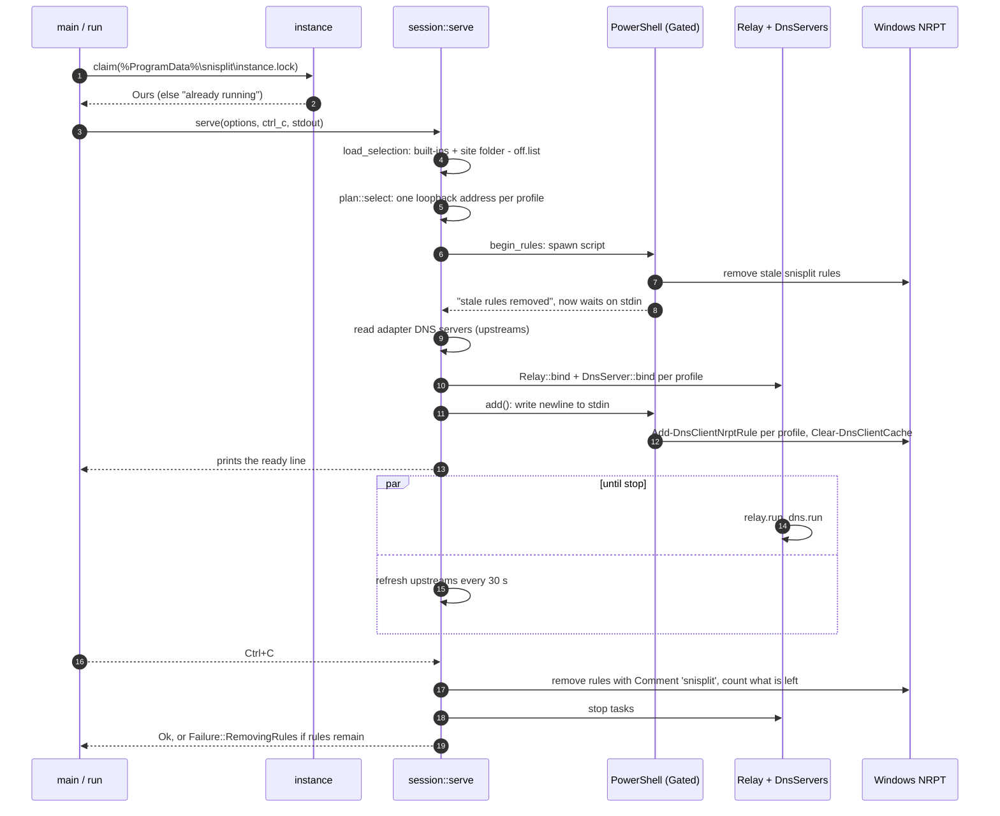

The two-step PowerShell start exists so that rules are never added before the sockets
are bound: if binding fails, or the user stops during start-up, the child is abandoned
(stdin closed) and adds nothing. Rules carry the comment `snisplit`, so `cleanup` and
the next `run` can find and remove leftovers after a crash.

Where things live on disk:

| Path | Written by | Read by |
|---|---|---|
| `%APPDATA%\snisplit\sites\<name>.profile` | GUI "Add", or the user by hand | `run`, GUI |
| `%APPDATA%\snisplit\off.list` | GUI switches | `run` (unless `--profile` is given), GUI |
| `%ProgramData%\snisplit\instance.lock` | whichever snisplit runs | CLI and GUI, one instance per machine |
| `crates/cli/profiles/*.profile` | developers | compiled in as `BUILT_IN` |

## 6. GUI crate

The GUI is an Elm-style loop. `State` is pure and fully unit-tested: it takes an `Event`
and returns `Effect`s. `Driver` performs effects (files, sessions, probes) on a tokio
runtime and sends results back as new events. `view` turns `State` into plain view
structs, and `window` / `widgets` draw them with egui.

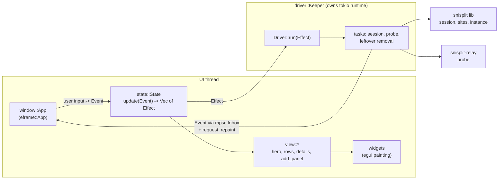

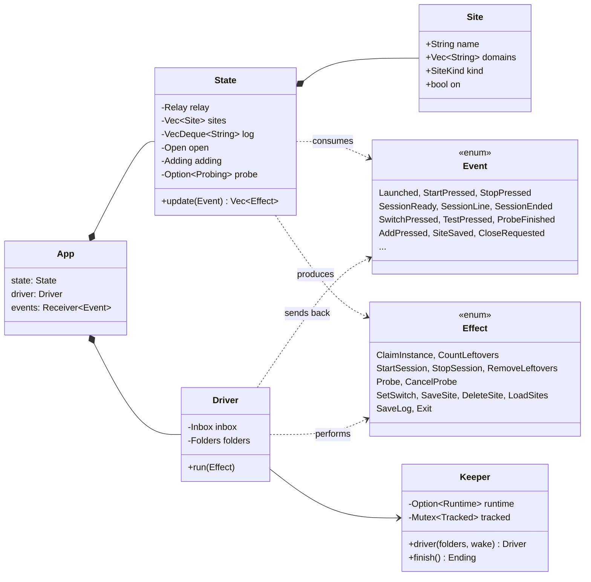

`Keeper` outlives the window: `Keeper::finish` (and its `Drop`) stops a running session
and waits up to 60 s for the DNS rules to be removed, so closing the window, or a panic
in the UI, does not leave rules behind.

The round button follows `state::Relay`:

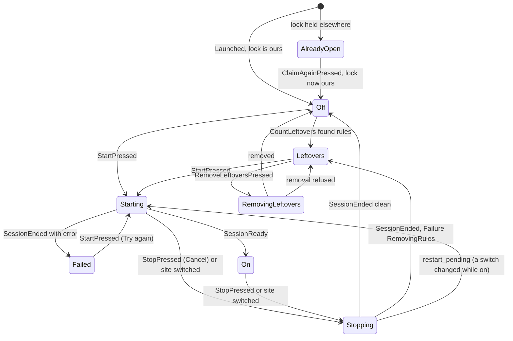

## 7. Probe: "is this site blocked, and what works?"

Used by `snisplit probe <domain>` and the GUI's Test button. It does not need routing or
administrator rights: it connects straight to the real address.

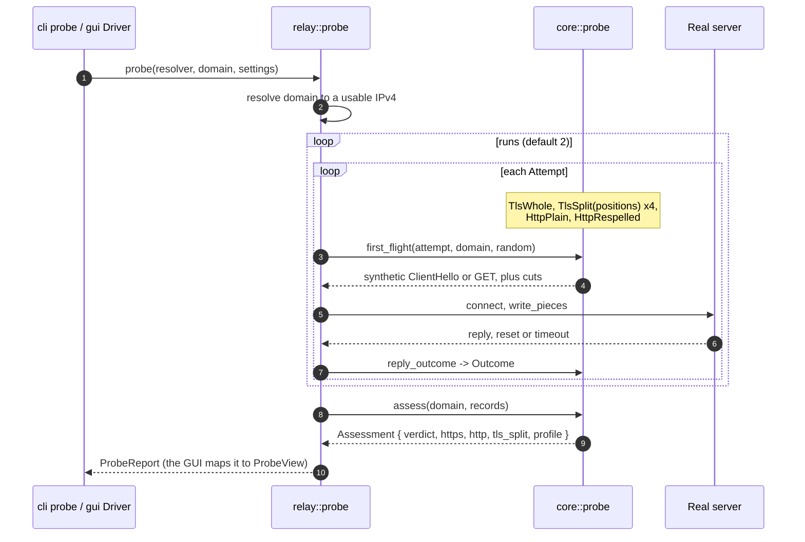

`Verdict` is one of `NotBlocked`, `ProfileSuggested` (with the profile text to save),
`NoProfileHelps`, `NothingWorked`.

## 8. Where to start reading

1. `crates/core/src/first_flight.rs`, then `strategy.rs`, `domains.rs`, `tls.rs`.
2. `crates/relay/src/connection.rs` (`serve`), `pieces.rs`, `dns_server.rs`.
3. `crates/cli/src/session.rs` (`serve_on`, `Session`), `plan.rs`, `routing.rs`.
4. `crates/gui/src/state.rs` (`update`), then `driver.rs`.

Tests: `cargo test --workspace`. Integration tests under `crates/*/tests/` run the relay
and DNS server on loopback with fake resolvers; `crates/core/tests/` replays real
ClientHellos captured from Chrome and Steam. Elevated, end-to-end checks are the
PowerShell scripts in `tools/acceptance/`.
